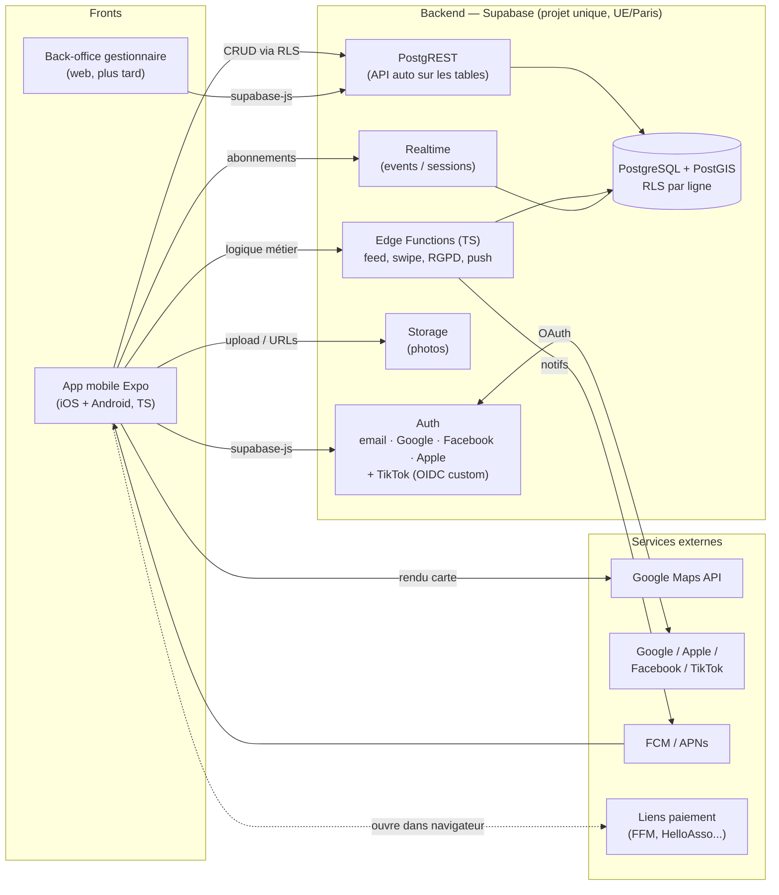

# Architecture — Meet & Shred

Socle figé par [ADR-0001](../docs/adr/0001-socle-technique-expo-supabase.md) : **Expo** (fronts) + **Supabase** (backend tout-en-un). Pas de serveur maison ; la sécurité vit dans la base via **RLS**.

## Principes

- **La base EST le backend.** L'app parle à Supabase via `supabase-js` ; PostgREST génère l'API sur les tables ; **RLS** (règles par ligne dans Postgres) remplace un middleware serveur.
- **Logique métier** (feed discipline/distance, swipe, RGPD, orchestration push) → **Edge Functions** (serverless TypeScript, type Lambda).
- **Pas de serveur maison** entre l'app et la base au MVP.
- **Externes** : Google Maps (cartes), providers OAuth, FCM/APNs (push), liens de paiement ouverts dans le navigateur.

## Évolutivité

Montée en charge par paliers incrémentaux : scaling vertical → read replicas → CDN → extraction d'un service dédié (Lambda/Cloud Run) pour une brique chaude. Les Edge Functions sont déjà du serverless. Porte de sortie : la base est du **Postgres standard** (migration par dump/restore). Voir ADR-0001.
