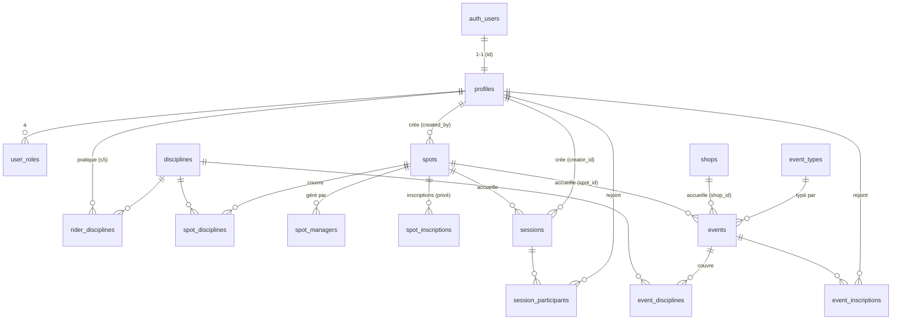

# Modèle de données consolidé — cœur de boucle

> **Pourquoi ce document ?** Avec Supabase (voir [ADR-0001](adr/0001-socle-technique-expo-supabase.md)), on ne code pas de routes REST maison. Le « contrat d'API » de l'app = **le schéma de base** (exposé par PostgREST) + **les politiques RLS** + **quelques fonctions** (RPC Postgres / Edge Functions). Ce document pose ce contrat **pour le cœur de boucle avant d'écrire les migrations**, afin que les entités partagées (spots ↔ sessions ↔ events) restent cohérentes.
>
> **Périmètre** : cœur de boucle (identité, disciplines, spots, sessions, events). Les entités des autres changes (équipement/photos détaillés, shops, reviews, moderation, social/DM, notifications) sont listées en fin de document et seront ajoutées **au fil de l'eau** dans leur change. Source : `openspec/changes/*/design.md`.

## Vue d'ensemble (relations)

## Tables

### Identité & rôles

**`profiles`** — profil applicatif, 1-1 avec `auth.users` (géré par Supabase Auth).
| colonne | type | notes |
|---|---|---|
| `id` | uuid PK | = `auth.users.id` (FK) |
| `first_name`, `last_name` | text | collectés à l'inscription (ou onboarding — décision en attente) |
| `bio` | text null | optionnel |
| `main_location` | geography(Point,4326) null | lieu principal optionnel |
| `terms_accepted_at` | timestamptz | consentement RGPD |
| `terms_version` | text | version des CGU acceptées |
| `age_confirmed_at` | timestamptz | case « 16 ans ou plus » |
| `created_at` | timestamptz | trigger à la création du compte |

**`user_roles`** — rôles élevés (rider est implicite pour tout profil).
| colonne | type | notes |
|---|---|---|
| `user_id` | uuid FK→profiles | |
| `role` | text | `spot_manager` \| `organisateur` \| `super_admin` |
| | | PK (`user_id`, `role`) ; attribué par super_admin |

### Disciplines (extensible — jamais un enum)

**`disciplines`**
| colonne | type | notes |
|---|---|---|
| `id` | uuid PK | |
| `slug` | text UNIQUE | ex. `mx`, `dh`, `kite` |
| `label` | jsonb | `{ fr, en, es }` |
| `icon` | text | |
| `category` | text | `moto` \| `velo` \| `eau` \| `snow` \| `urban` (regroupement UI) |
| `equipment_schema` | jsonb | liste de champs `{slug,label,type,required}` du matériel |

**`rider_disciplines`** — N:N rider↔discipline, **plafonné à 5 par rider**.
| colonne | type | notes |
|---|---|---|
| `rider_id` | uuid FK→profiles | |
| `discipline_id` | uuid FK→disciplines | |
| `level` | text | niveau auto-déclaré, **par discipline** |
| | | PK (`rider_id`,`discipline_id`) ; limite 5 vérifiée côté serveur (trigger) |

### Spots

**`spots`** — fiche commune privé/public ; champs de gestion = privé uniquement.
| colonne | type | notes |
|---|---|---|
| `id` | uuid PK | |
| `category` | text | `private` (établissement géré) \| `public` (libre, gratuit) |
| `name` | text | |
| `description` | text null | |
| `location` | geography(Point,4326) | **PostGIS** + index GIST |
| `created_by` | uuid FK→profiles | créateur |
| `is_published` | bool | privé = false jusqu'à validation super_admin ; public = true immédiatement |
| `current_status` | text null | slug de statut (config `configs/spot-statuses/<discipline>.json`) — **privé only** |
| `max_capacity` | int null | privé only |
| `current_count` | int | privé only (maj atomique) |
| `payment_url` | text null | privé only (lien externe) |
| `created_at` | timestamptz | sert au rate-limit anti-spam (création publique) |

> Vocabulaire rider : jamais « privé/public » — pin plein (géré) / creux (libre) + « Gratuit »/« dès X € » (voir map-core).

**`spot_disciplines`** — N:N spot↔discipline.
`spot_id` FK, `discipline_id` FK, `is_primary` bool (statut affiché = discipline principale). PK (`spot_id`,`discipline_id`).

**`spot_managers`** — un spot privé peut avoir plusieurs gestionnaires.
`spot_id` FK, `user_id` FK→profiles, `role` (`owner` \| `admin`). PK (`spot_id`,`user_id`).

**`spot_inscriptions`** — inscriptions (privé, pour le compteur de capacité ; paiement externe).
`id` PK, `spot_id` FK, `rider_id` FK→profiles, `created_at`.

### Sessions (sorties libres, sans rôle/capacité/paiement)

**`sessions`**
| colonne | type | notes |
|---|---|---|
| `id` | uuid PK | |
| `spot_id` | uuid FK→spots | **NOT NULL** (toujours liée à un spot existant) |
| `creator_id` | uuid FK→profiles | |
| `starts_at` | timestamptz | pas d'heure de fin saisie ; « en cours » = `[starts_at, starts_at+3h]` |
| `note` | text null | modifiable par le créateur |
| `status` | text | `active` \| `cancelled` (annulation explicite → notif participants) |
| `created_at` | timestamptz | |

> Pas de champ discipline : le filtrage se fait via `spot_disciplines` du spot lié.

**`session_participants`** — `session_id` FK, `rider_id` FK→profiles. PK (`session_id`,`rider_id`).

### Events (réservés à un rôle)

**`event_types`** — types extensibles (config en table, modifiable par super_admin).
| colonne | type | notes |
|---|---|---|
| `slug` | text PK | `spot_event`,`bbq`,`ride_day`,`bike_test`,`track_day`,`competition`,`shop_event` |
| `label` | jsonb | `{ fr, en, es }` |
| `icon` | text | |
| `creator_role` | text | rôle requis (`spot_manager` \| `organisateur` \| shop manager) |
| `capacity_required` | bool | track_day/competition = true |

**`events`**
| colonne | type | notes |
|---|---|---|
| `id` | uuid PK | |
| `type_slug` | text FK→event_types | |
| `spot_id` | uuid null FK→spots | **XOR** avec shop_id |
| `shop_id` | uuid null FK→shops | voir shop-core |
| `creator_id` | uuid FK→profiles | |
| `title`, `description` | text | |
| `starts_at`, `ends_at` | timestamptz | |
| `max_capacity` | int null | optionnelle selon le type |
| `current_count` | int | maj atomique |
| `price`, `currency` | numeric/text null | facultatif ; sans prix = gratuit |
| `payment_url` | text null | lien externe |
| `status` | text | `active` \| `cancelled` ; archivage 24 h après `ends_at` |

> Contrainte CHECK : exactement un de (`spot_id`, `shop_id`) non nul.

**`event_disciplines`** — `event_id` FK, `discipline_id` FK. PK (`event_id`,`discipline_id`).
**`event_inscriptions`** — `event_id` FK, `rider_id` FK→profiles. PK (`event_id`,`rider_id`).

## Politiques RLS (résumé — deny par défaut, policies explicites)

| Table | SELECT | INSERT | UPDATE / DELETE |
|---|---|---|---|
| `profiles` | tout rider connecté | via trigger à l'inscription | **soi-même** |
| `user_roles` | soi-même + super_admin | super_admin | super_admin |
| `disciplines`, `event_types` | public (référentiel) | super_admin | super_admin |
| `rider_disciplines` | tout rider connecté | **soi-même** (≤5) | **soi-même** |
| `spots` | published = tous ; non-published = créateur/managers/super_admin | public = tout rider ; privé = `spot_manager` | créateur, `spot_managers`, super_admin |
| `spot_disciplines`, `spot_managers`, `spot_inscriptions` | selon le spot | géré par le spot / soi-même (inscription) | créateur du spot / super_admin |
| `sessions` | actives dans la fenêtre = tous | tout rider (spot existant) | **créateur** (modifier/annuler) |
| `session_participants` | tous | **soi-même** (rejoindre) | **soi-même** (quitter) |
| `events` | published = tous | rôle requis (`creator_role` du type) | créateur / managers / super_admin |
| `event_disciplines` | tous | créateur de l'event | créateur |
| `event_inscriptions` | tous | **soi-même** | **soi-même** |

> `super_admin` et le service_role contournent RLS pour la modération (voir moderation-core).

## Surface « API » = PostGREST + fonctions

- **CRUD standard** (lister/lire/créer spots, sessions, inscriptions, profils…) → directement via **PostgREST + `supabase-js`**, protégé par les RLS ci-dessus. Pas de code serveur à écrire.
- **Fonctions Postgres (RPC)** — logique qui doit être atomique ou géo, exposée via PostgREST :
  - `feed_near(lat, lng, radius_m, discipline_ids[])` → spots/events/sessions autour, triés par distance (**PostGIS**), fenêtre 2 semaines pour events/sessions. *(cœur de l'écran Carte)*
  - `create_public_spot(name, lat, lng, discipline_ids[])` → crée un spot libre avec garde-fous (doublon < 200 m, rate-limit).
  - `join_event(event_id)` / `join_session(session_id)` → inscription **atomique** (SELECT FOR UPDATE) si capacité.
  - `cancel_session(session_id)` → passe `cancelled` + déclenche la notif (voir notifications-push).
- **Edge Functions (TypeScript)** — ce qui sort de la base :
  - `delete-account`, `export-data` (RGPD, voir auth-registration).
  - orchestration push (FCM/APNs) — voir notifications-push.
  - (plus tard) OIDC TikTok, revendication de spot.

## Hors cœur de boucle (à ajouter au fil de l'eau, dans leur change)

- **rider-profile** : `rider_equipment` (fields JSONB, N setups/discipline), `profile_photos`, `equipment_photos`.
- **shop-core** : `shops` (+ `shop_disciplines`, horaires, marques) — déjà référencée par `events.shop_id`.
- **reviews-core** : `reviews` (spots/shops/events, preuve de participation).
- **moderation-core** : `reports` + file de modération.
- **rider-social** : `follows`, `activity_feed`, `direct_messages`.
- **notifications-push** : `push_tokens`, `notification_preferences`.
- **i18n-core** : préférence de langue (sur `profiles`).
